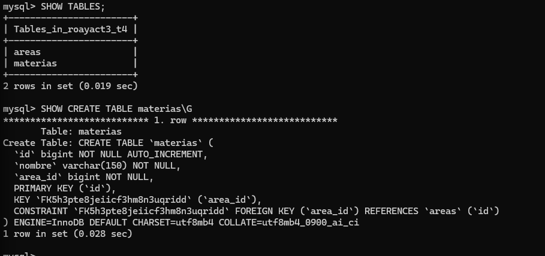
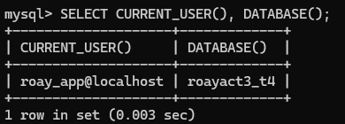
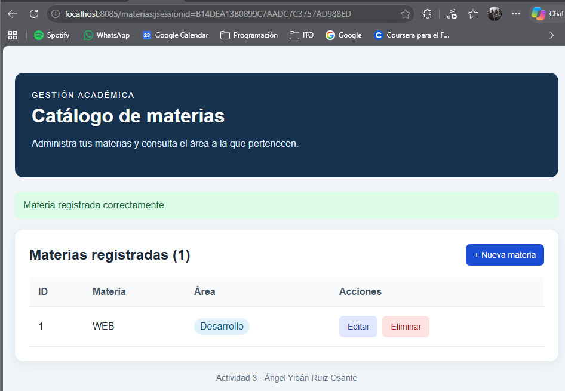
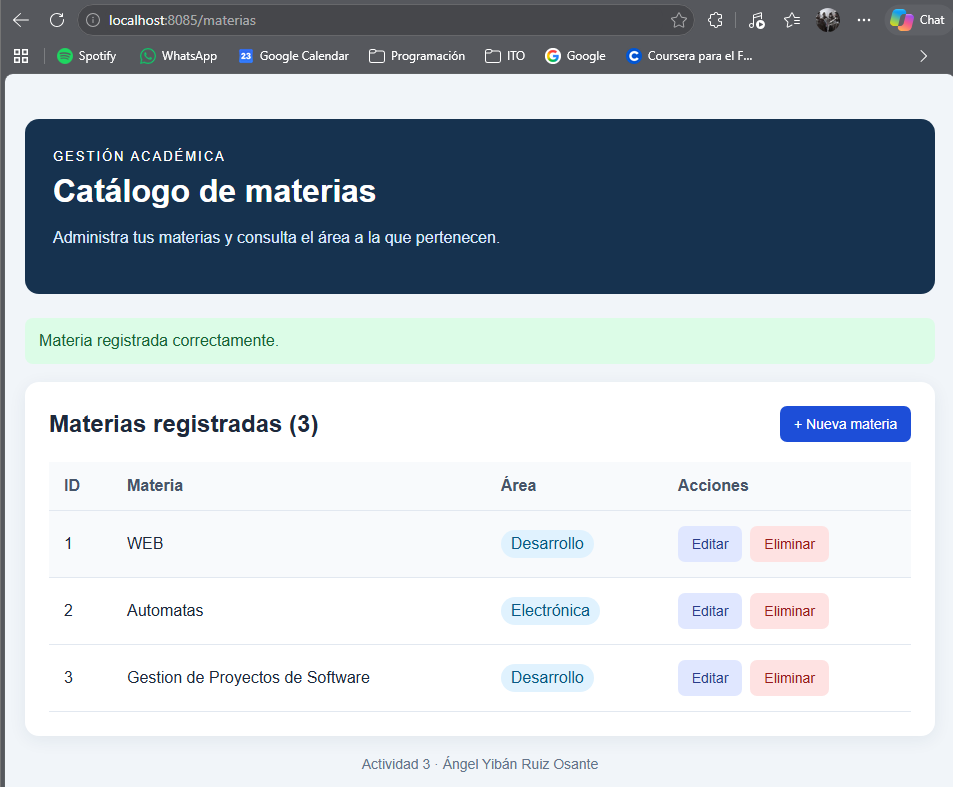
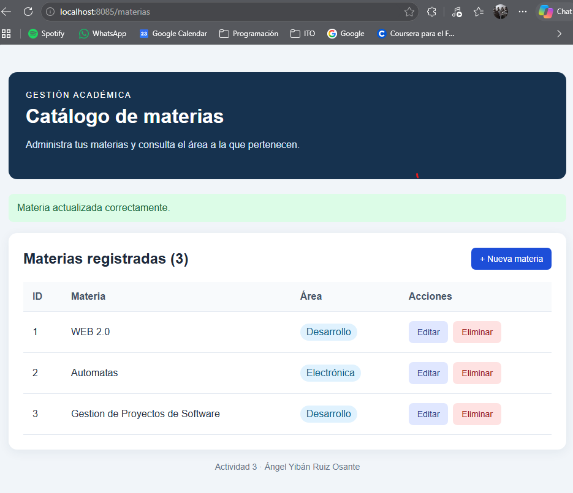
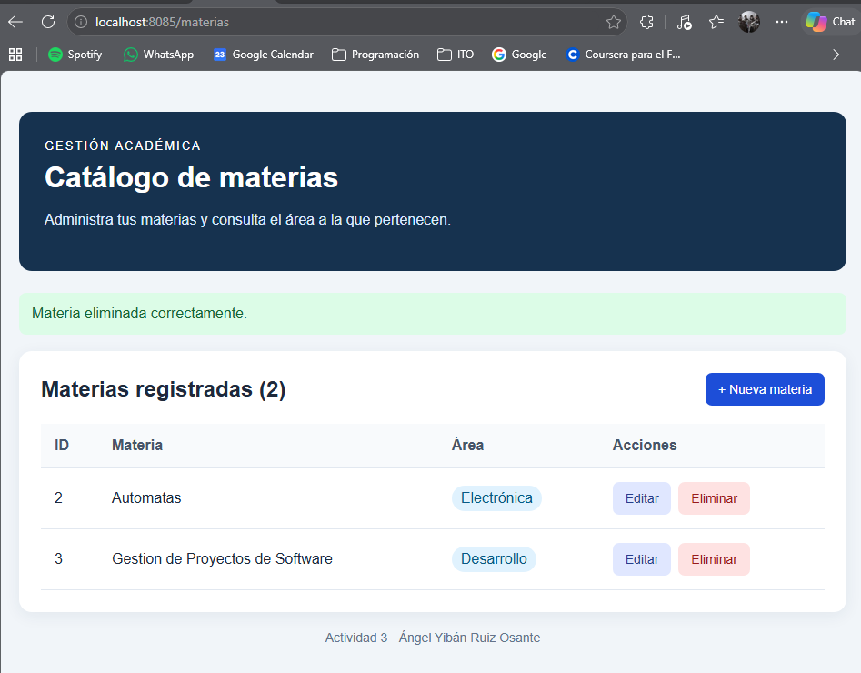

# Actividad 3 — CRUD de materias con Spring Boot y MySQL

**Alumno:** Ángel Yibán Ruiz Osante  
**Materia:** Programación Web

## Descripción

Aplicación web para crear, consultar, actualizar y eliminar materias.
Cada materia pertenece a un área y sus datos se almacenan en una base
de datos MySQL.

Se utilizaron vistas Thymeleaf y estilos CSS dentro del mismo proyecto
Spring Boot, sin un frontend separado. Las pruebas del CRUD se realizaron
desde los formularios y el listado de la aplicación.

## Enlaces

- [Repositorio de GitHub](https://github.com/AngelOxe/ROAYact3_t4)
- [Actividad 3 — CRUD de materias](http://138.68.234.30:8085/materias)
- [Actividad 1 — Identificación del proyecto](http://138.68.234.30:8081/proyecto)
- [Actividad 2 — Catálogo MVC](http://138.68.234.30:8083/catalogo)

La actividad 3 utiliza el puerto **8085** y la carpeta
`~/practicas/ROAYact3_t4`, independientes de las actividades anteriores.

## Tecnologías utilizadas

- Java 21.
- Spring Boot 4.1.2.
- Spring Web MVC.
- Spring Data JPA y Hibernate.
- MySQL.
- Thymeleaf.
- Maven y Maven Wrapper.
- HTML y CSS.
- Visual Studio Code.
- Git y GitHub.

## Entidades y relación

Se implementaron dos entidades:

| Entidad | Atributos | Descripción |
|---|---|---|
| Area | id, nombre | Representa un área académica. Su nombre es único. |
| Materia | id, nombre, area | Representa una materia que pertenece a un área. |

La relación es **muchos a uno**: varias materias pueden pertenecer a una
misma área, mientras que cada materia debe tener un área.

En `Materia.java` se definió:

```java
@ManyToOne(fetch = FetchType.LAZY, optional = false)
@JoinColumn(name = "area_id", nullable = false)
private Area area;
```

La columna `materias.area_id` es una llave foránea que referencia
`areas.id`. Esta relación está definida desde `Materia`; no fue necesario
agregar una colección con `@OneToMany` en `Area`.

En la página del listado se muestra el **nombre del área**, no solamente
su identificador. Las consultas del repositorio utilizan `@EntityGraph`
para cargar el área junto con la materia.

## Organización del proyecto

El paquete principal es `mx.ito.demoCrud`.

| Capa | Archivos | Responsabilidad |
|---|---|---|
| Entidades | Area.java y Materia.java | Representar las tablas y su relación. |
| Repositorios | AreaRepository.java y MateriaRepository.java | Acceder a MySQL mediante JpaRepository. |
| Servicios | AreaService.java y MateriaService.java | Validar datos y realizar las operaciones del CRUD. |
| Controlador | MateriaController.java | Recibir peticiones, llamar a los servicios y preparar las vistas. |
| Vistas | lista.html y formulario.html | Mostrar registros y capturar datos. |
| Configuración | application.properties | Configurar el puerto y la conexión a la base de datos. |

La lógica de negocio se encuentra en los servicios. El controlador
no accede directamente a los repositorios.

## Funcionalidades y validaciones

- Registrar una materia con un área existente.
- Consultar todas las materias y el nombre de su área.
- Editar una materia conservando su identificador.
- Eliminar una materia con confirmación desde el navegador.
- Mostrar mensajes de éxito y errores de validación.
- Rechazar nombres vacíos o mayores de 150 caracteres para las materias.
- Comprobar que el área seleccionada exista.
- Conservar los datos después de reiniciar la aplicación.

El formulario se reutiliza para registrar y editar. Si no se recibe un
ID, se crea una materia; si se recibe uno, se actualiza el registro existente.

## Rutas de la aplicación

| Método | Ruta | Función |
|---|---|---|
| GET | `/` | Redirigir al listado. |
| GET | `/materias` | Consultar las materias y sus áreas. |
| GET | `/materias/nueva` | Mostrar el formulario de registro. |
| GET | `/materias/{id}/editar` | Mostrar el formulario de edición. |
| POST | `/materias/guardar` | Crear o actualizar una materia. |
| POST | `/materias/{id}/eliminar` | Eliminar una materia. |

Estas rutas pertenecen a un controlador MVC y devuelven vistas HTML
o redirecciones. Los formularios envían sus campos mediante POST.

## Configuración local

### 1. Requisitos

- JDK 21.
- MySQL instalado y en ejecución.
- Git para clonar el repositorio.

El proyecto incluye Maven Wrapper, por lo que no es necesario instalar
Maven por separado.

### 2. Obtener el proyecto

```powershell
git clone https://github.com/AngelOxe/ROAYact3_t4.git
cd ROAYact3_t4
```

### 3. Preparar la base de datos

Desde una sesión administradora de MySQL, ejecutar una sola vez:

```sql
CREATE DATABASE roayact3_t4 CHARACTER SET utf8mb4;

CREATE USER 'roay_app'@'localhost'
IDENTIFIED BY 'REEMPLAZAR_POR_UNA_CLAVE_PROPIA';

GRANT ALL PRIVILEGES ON roayact3_t4.*
TO 'roay_app'@'localhost';
```

El texto de contraseña es un ejemplo: debe sustituirse por una clave
propia. Si la base o el usuario ya existen, revisar su configuración
antes de repetir los comandos.

### 4. Configuración de Spring Boot

El archivo `src/main/resources/application.properties` contiene:

```properties
spring.application.name=roayact3

server.port=8085

spring.datasource.url=${DB_URL:jdbc:mysql://localhost:3306/roayact3_t4}
spring.datasource.username=${DB_USER:roay_app}
spring.datasource.password=${DB_PASSWORD}

spring.jpa.hibernate.ddl-auto=update
spring.jpa.open-in-view=false

spring.thymeleaf.cache=false
```

La contraseña se obtiene mediante una variable de entorno y no se guarda
en el repositorio.

`ddl-auto=update` permite crear o actualizar las tablas a partir de las
entidades. Esta configuración se utilizó para la práctica.

### 5. Configurar las variables e iniciar

En PowerShell, desde la carpeta que contiene `pom.xml`:

```powershell
$env:DB_URL = "jdbc:mysql://localhost:3306/roayact3_t4"
$env:DB_USER = "roay_app"

$credencialBD = Get-Credential -UserName "roay_app" -Message "Contraseña de MySQL local"
$env:DB_PASSWORD = $credencialBD.GetNetworkCredential().Password

$env:SERVER_PORT = "8085"

.\mvnw.cmd spring-boot:run
```

Las variables deben configurarse en la misma sesión de PowerShell desde
la que se ejecuta Maven.

Abrir: http://localhost:8085/materias

### 6. Cargar las áreas iniciales

Después del primer arranque, Hibernate habrá creado las tablas.
En MySQL, comprobar primero su contenido:

```sql
USE roayact3_t4;
SELECT * FROM areas;
```

Si la tabla está vacía, ejecutar:

```sql
INSERT INTO areas (nombre)
VALUES
    ('Desarrollo'),
    ('Redes'),
    ('Investigación'),
    ('Gestión'),
    ('Electrónica'),
    ('Análisis de datos');
```

Las áreas se cargaron manualmente. No se debe repetir esta inserción
si ya existen. Las materias se registran desde el formulario web.

## Pruebas realizadas y evidencias

Las siguientes capturas corresponden a las pruebas locales.
El CRUD también se probó desde las vistas de la aplicación en el VPS.

### 1. Tablas y relación

Se comprobó la existencia de las tablas `areas` y `materias`,
incluyendo la llave foránea entre ambas.

```sql
SHOW TABLES;
SHOW CREATE TABLE materias;
```



### 2. Conexión a MySQL

Se verificó el usuario conectado y la base de datos seleccionada.

```sql
SELECT CURRENT_USER(), DATABASE();
```



### 3. Crear

Se registró una materia seleccionando un área existente.
La aplicación mostró el mensaje de confirmación y el nuevo registro.



### 4. Consultar

El listado muestra las materias almacenadas, sus identificadores y el
nombre del área relacionada.



### 5. Actualizar

Se modificaron los datos de una materia conservando su identificador.
El cambio se reflejó en el listado.



### 6. Eliminar

Se eliminó una materia mediante el botón correspondiente.
La aplicación confirmó la operación y el registro dejó de aparecer.



### Persistencia

Se reinició la aplicación local y se verificó que los cambios permanecían.
Los datos se almacenan en MySQL, no en una lista temporal de Java.

Para consultar directamente las materias y sus áreas se utilizó:

```sql
SELECT
    m.id,
    m.nombre AS materia,
    m.area_id,
    a.nombre AS area
FROM materias m
INNER JOIN areas a ON m.area_id = a.id
ORDER BY m.id;
```

Las pruebas se realizaron desde las vistas Thymeleaf, una de las
opciones permitidas por la actividad. No se utilizó una colección
de Postman o Bruno.

## Compilación

Con MySQL local activo y las variables de conexión configuradas:

```powershell
.\mvnw.cmd clean package
```

Este comando compila, ejecuta las pruebas y genera:

```text
target/demoCrud-0.0.1-SNAPSHOT.jar
```

La prueba de arranque necesita acceso a la base de datos.
El proceso debe terminar con `BUILD SUCCESS`.

## Despliegue en el VPS

| Elemento | Valor |
|---|---|
| IP | 138.68.234.30 |
| Puerto de la actividad 3 | 8085 |
| Carpeta | ~/practicas/ROAYact3_t4 |
| Archivo ejecutable | app.jar |
| Base de datos | roayact3_t4 |
| Usuario de la aplicación en MySQL | roay_act3 |

La base del VPS es independiente de la base local.
El JAR contiene el código y las vistas, pero no los registros de MySQL.

### Preparación de MySQL en el VPS

Se utilizó la instalación de MySQL que ya existía en el servidor.
Desde una sesión administradora se crearon una base y un usuario
exclusivos para esta actividad:

```sql
CREATE DATABASE roayact3_t4 CHARACTER SET utf8mb4;

CREATE USER 'roay_act3'@'localhost'
IDENTIFIED BY 'REEMPLAZAR_POR_UNA_CLAVE_PROPIA';

GRANT ALL PRIVILEGES ON roayact3_t4.*
TO 'roay_act3'@'localhost';
```

Estos comandos son de preparación inicial y no deben repetirse si
los recursos ya existen.

### Transferencia del JAR

Desde PowerShell de la laptop, con el JAR compilado:

```powershell
ssh -i "$env:USERPROFILE\.ssh\medicita_eq02" medicita@138.68.234.30 "mkdir -p ~/practicas/ROAYact3_t4"
```

```powershell
scp -i "$env:USERPROFILE\.ssh\medicita_eq02" .\target\demoCrud-0.0.1-SNAPSHOT.jar medicita@138.68.234.30:~/practicas/ROAYact3_t4/app.jar
```

La ruta de la llave corresponde al equipo utilizado para la práctica.
La llave privada y las contraseñas no se incluyen en el repositorio.

### Configuración en el servidor

Dentro de la sesión SSH:

```bash
cd ~/practicas/ROAYact3_t4

export DB_URL='jdbc:mysql://127.0.0.1:3306/roayact3_t4'
export DB_USER='roay_act3'

read -s -p "Contraseña MySQL de roay_act3: " DB_PASSWORD
echo
export DB_PASSWORD
```

Antes de iniciar, comprobar que el puerto esté libre:

```bash
ss -ltn 'sport = :8085'
```

Si ya aparece un proceso escuchando, no se debe iniciar otra instancia
en el mismo puerto.

### Arranque

```bash
nohup java -Xms32m -Xmx128m -XX:+UseSerialGC -jar app.jar --server.port=8085 --spring.datasource.hikari.maximum-pool-size=3 --spring.datasource.hikari.minimum-idle=1 > app.log 2>&1 &
```

Se limitó el heap de Java y el número de conexiones para reducir el
consumo de recursos del VPS compartido. El consumo total de memoria
del proceso puede superar el límite del heap.

Consultar el registro:

```bash
tail -n 60 app.log
```

Después del primer arranque, se cargaron en la base del VPS las áreas
iniciales indicadas en la sección de configuración local.

`nohup` permite que la aplicación continúe después de cerrar SSH.
No configura un arranque automático después de reiniciar el VPS:
en ese caso se deben volver a establecer las variables e iniciar
la aplicación.

### Verificación

Desde el VPS:

```bash
curl --max-time 15 -s -o /dev/null -w 'Actividad 3: HTTP %{http_code}\n' http://127.0.0.1:8085/materias
```

Desde un navegador externo:

http://138.68.234.30:8085/materias

Las actividades anteriores utilizan otros puertos:

- Actividad 1: 8081.
- Actividad 2: 8083.
- Actividad 3: 8085.

## Historial de desarrollo

El trabajo se distribuyó en commits para registrar avances:

1. Proyecto base y dependencias.
2. Configuración de MySQL y entidades relacionadas.
3. Repositorios y servicios.
4. Controlador MVC y vistas del CRUD.
5. Documentación y capturas.

## Referencia

- [Video: CRUD con Spring Boot 4 + JPA](https://www.youtube.com/watch?v=uTwxbOnwB9k)
- [Guía de referencia](https://blog.edticsacademy.com/2026/03/crud-con-spring-boot-4-jpa-mysql.html)

Se adaptó el ejemplo al tema de materias y áreas, utilizando una relación
JPA real, una capa de servicios y vistas propias con CSS.